# Play Simi mobile playtest release

All eight phases are deployed at https://playsimi.danielquek.com. The final source integrates main at `2f0308a`, including its character, music, accepted-friend privacy, save retry and first-race improvements. Worker version: `36d5a56b-2de6-44f9-be11-504450925f0e`.

## Changes by phase

1. **Movement and camera.** Fixed 60 Hz movement with per-frame interpolation; the camera follows the final rendered avatar pose. Automatic quality changes wait until the player stops. Expanded solid-prop footprints and swept route checks prevent thin props being skipped. Pinch and button zoom reach an outfit-sized view, with a 2.7 minimum follow distance and a 12 maximum.
2. **Mobile HUD and jumping.** Replaced the bottom bar with a top-corner avatar/XP pill and floating Play, My look and Menu buttons. Four favourite emotes sit beside Jump, with More opening the full list. Pads reach arcade, shop and dragon roofs; three daily jump stars award 10 XP each and a 30 XP completion bonus. The hunt resets on Singapore time and keeps existing collectibles intact. Resting HUD controls measured about 7.7% of 390 by 844 pixels; transient prompts and open panels are excluded.
3. **Navigation and automatic idle.** Play contains all seven arcade games plus outside activities. Cards start the game or activity directly. Menu contains My look, Quests & rankings, Sound & display, Change world, the appropriate email/logout action, and small Privacy & data and Help/Report links. Quests has Rankings and Challenges tabs and the daily hat. After 60 seconds without input, or when the page becomes hidden, the avatar uses a relaxed idle action; returning input resumes play. Profiles retain safety controls.
4. **My look.** Free/owned cards equip immediately. Locked cards preview and offer Get on the card; Undo and Back to my look remain in the pinned preview. Slot tabs and ownership/class/style filters replace the old collection navigation. All 16 Premium sets have real renders; purchases remain locked below 18. New upstream hair and class items retain their stable IDs and fit the slot filters.
5. **Touch game controls.** World, arcade and Coast Rush share the joystick binding. Noodle turns, Brick moves the paddle or accepts dragging, Hop jumps, and Swarm moves with auto-fire after movement. Coast uses steering, GO and DRIFT; item use remains available. Hoops and Fishing keep large action buttons. Keyboard and mouse controls remain available.
6. **Star Swarm.** Daytime art, outlined orange enemy bullets, readable enemies and avatar ship. Health pickups provide an eight-second shield that absorbs two hits without restoring health. Waves ramp every 12 seconds; a boss arrives at 35 seconds with a second attack phase. Unattended simulation earns zero points and ends by 12 seconds. Browser play holds before first input, then verified active runs continued past eight seconds. Replay version 2 preserves validation of prior version-1 runs, including the former negative-seed participation rule.
7. **Plaza Relay.** Glowing gates run through the real 3D plaza using the normal avatar and Jump. Existing team codes accept friends. Solo starts with three computer teammates and four opponents, with distinct looks and names. A server clock, bounded movement reports, jump gates, baton handoffs and results drive the course. Relay does not award competitive XP or tokens. Lightweight 2D fallback remains available.
8. **Remaining reviewer fixes.** Seated bucket/Coral Pirate headgear, a procedural tricorn, full Knight helmet and Bear ears; selected eye colours and cape collar/sway; live player counts and friend/nearby-only lists; selected profile routing; first-click camera toggle and a one-time Performance explanation with Switch back. Race again keeps 180 seconds until a first finish, then explains the 120-second standard limit. End cards retain this round's score and visible Play again controls; level rewards wait while a game/panel is active. Native selects and checkboxes are presented through styled listboxes and switches. Open Stage hints identify four lanes in Show mode, and idle zero-score shows cannot earn XP.

## Verification

- Integrated build: 443 tests passed, no skips, including browser fixtures. A subsequent targeted pass passed 19 checks after the final wardrobe-filter and daily-star refresh edits, adding one regression test.
- Cloudflare integration: 14 passed. TypeScript/Vite build and Worker deployment succeeded. The build still reports its existing large-bundle advisory.
- Production `/api/health` returned ready. SHA-256 matched all 15 JavaScript assets and five changed headwear images against the local build.
- Chromium used actual 390 by 844 and 844 by 390 CSS viewports, plus desktop. Native browser touch events exercised pinch and arcade joystick controls. Additional automated fixtures cover 320 by 568.
- Walking/zoom were exercised in Automatic, Quality and Performance. Fixed-step motion is also tested at 30, 60, 90 and 144 Hz. Roof flight and collection, one-tap equip/Undo, 16 decoded Premium images, one-click replay, first-click camera and a real 61-second idle/resume were checked.
- Solo Relay reached a real jump checkpoint and baton handoff in the 3D world; server tests cover completion, friend-code joins, bots and invalid movement. Swarm active play showed 100 points after nine seconds and 300 after eighteen seconds.
- Save reopen tests preserve accounts, balances, ownership and prior item IDs. Existing payment webhook and authorization tests pass. No production profiles or real purchases were created for QA; gameplay used a disposable local data store.
- Local gameplay browser errors were empty. The newly deployed public landing page produced no console/errors on the fresh check; its production gameplay was verified by deployed asset hashes, not a new production account.

## Verification limits

Phone screenshots are Chromium viewport emulation, not physical iPhone or Android captures. Physical-device GPU/frame pacing and multi-device friend play still need a real-device playtest. Jitter checks combine sampled on-screen motion and interpolation tests; they do not prove every device will render smoothly. Collision coverage was checked for the registered solid footprints, not an exhaustive manual traversal of every prop from every angle. Checkout was verified through tests, without a live Stripe charge. Props reuse existing accessory/class equipment, preserving item IDs rather than introducing a new independently saved hand slot.

## Phone screenshots

These are actual rendered local-build captures. Premium QA uses the local server, where live checkout is disabled. The rooftop-star capture was taken during Phase 2 before the later upstream character finish was integrated.

| Phase | Portrait 390 by 844 | Landscape 844 by 390 |
| --- | --- | --- |
| 1 | [Portrait](docs/mobile-playtest/phase1-portrait.png) | [Landscape](docs/mobile-playtest/phase1-landscape.png) |
| 2 | [Portrait](docs/mobile-playtest/phase2-portrait.png) | [Landscape](docs/mobile-playtest/phase2-landscape.png) |
| 3 | [Portrait](docs/mobile-playtest/phase3-portrait.png) | [Landscape](docs/mobile-playtest/phase3-landscape.png) |
| 4 | [Portrait](docs/mobile-playtest/phase4-portrait.png) | [Landscape](docs/mobile-playtest/phase4-landscape.png) |
| 5 | [Portrait](docs/mobile-playtest/phase5-portrait.png) | [Landscape](docs/mobile-playtest/phase5-landscape.png) |
| 6 | [Portrait](docs/mobile-playtest/phase6-portrait.png) | [Landscape](docs/mobile-playtest/phase6-landscape.png) |

[Premium](docs/mobile-playtest/premium-portrait.png) · [Jump star](docs/mobile-playtest/rooftop-star.png) · [Relay handoff](docs/mobile-playtest/relay-handoff.png) · [Result card](docs/mobile-playtest/result-landscape.png)

### Phase 1

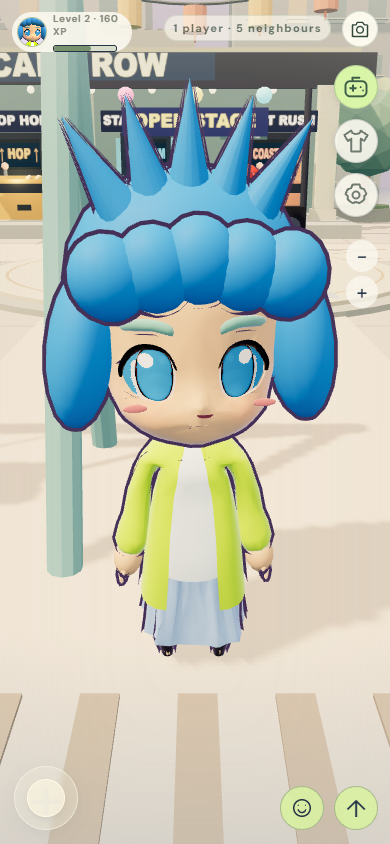

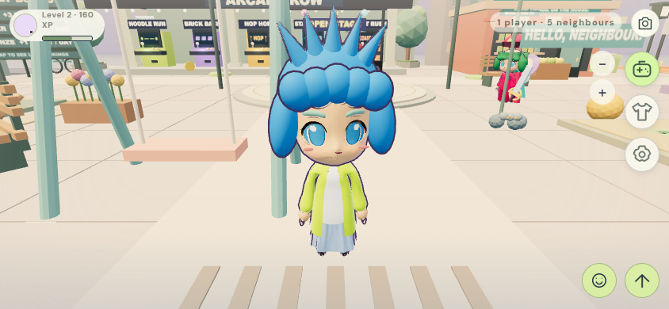

### Phase 2

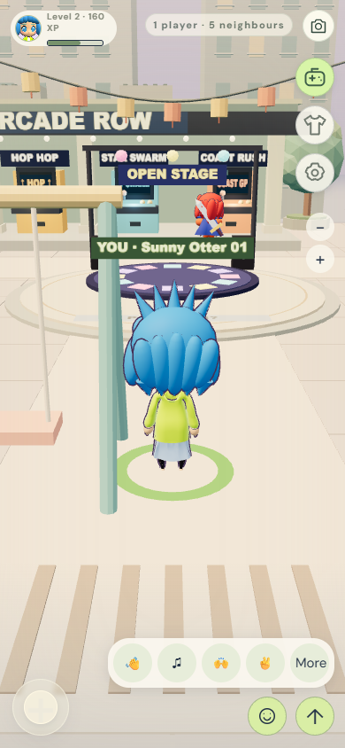

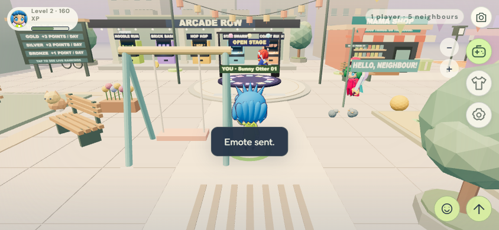

### Phase 3

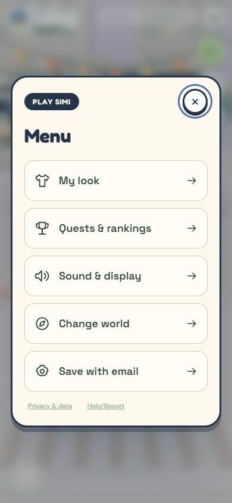

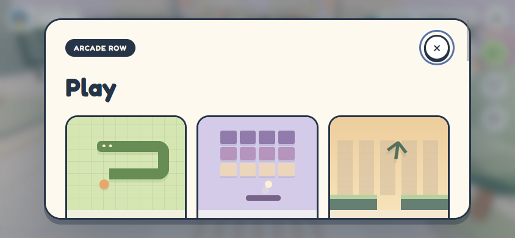

### Phase 4

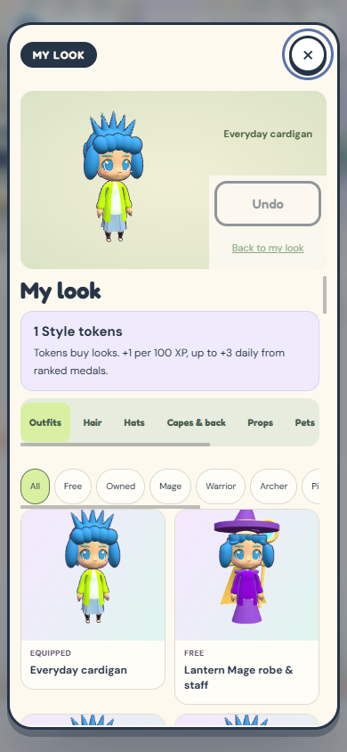

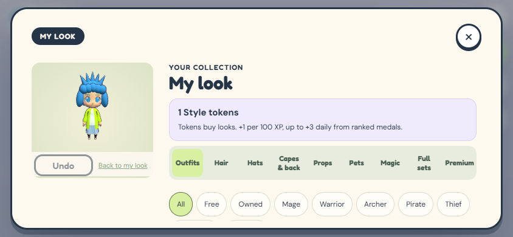

### Phase 5

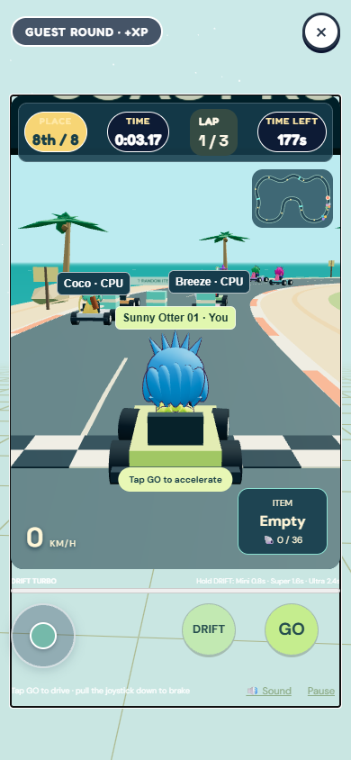

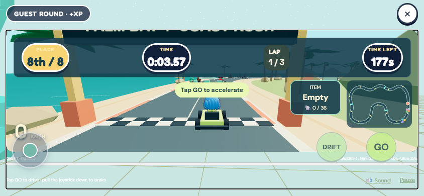

### Phase 6

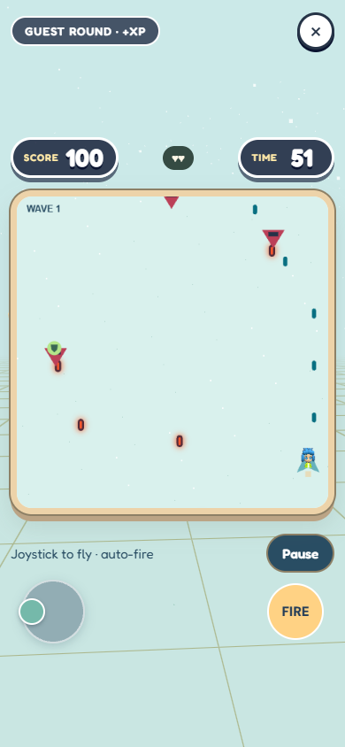

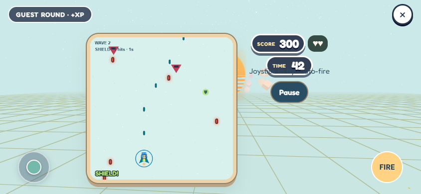

## Complete changed file inventory

Compared with integrated main `2f0308a`; upstream-only files are already in main and excluded. Unrelated local `HOSTING.md` edits and `play-simi-promo/` were preserved and excluded.

- `MOBILE-PLAYTEST.md`
- `docs/mobile-playtest/phase1-landscape.png`
- `docs/mobile-playtest/phase1-portrait.png`
- `docs/mobile-playtest/phase2-landscape.png`
- `docs/mobile-playtest/phase2-portrait.png`
- `docs/mobile-playtest/phase3-landscape.png`
- `docs/mobile-playtest/phase3-portrait.png`
- `docs/mobile-playtest/phase4-landscape.png`
- `docs/mobile-playtest/phase4-portrait.png`
- `docs/mobile-playtest/phase5-landscape.png`
- `docs/mobile-playtest/phase5-portrait.png`
- `docs/mobile-playtest/phase6-landscape.png`
- `docs/mobile-playtest/phase6-portrait.png`
- `docs/mobile-playtest/premium-portrait.png`
- `docs/mobile-playtest/relay-handoff.png`
- `docs/mobile-playtest/result-landscape.png`
- `docs/mobile-playtest/rooftop-star.png`
- `public/wardrobe/hair-10.png`
- `public/wardrobe/hair-25.png`
- `public/wardrobe/hair-6.png`
- `public/wardrobe/hair-7.png`
- `public/wardrobe/hair-9.png`
- `server/community-core.mjs`
- `server/payments.mjs`
- `server/relay.mjs`
- `shared/plaza-relay.ts`
- `shared/relay-protocol.ts`
- `shared/simulation.ts`
- `src/account.ts`
- `src/action-games.ts`
- `src/appearance.ts`
- `src/arcade-fx.ts`
- `src/avatar-portraits.ts`
- `src/catalog.ts`
- `src/character.ts`
- `src/games.ts`
- `src/headgear.ts`
- `src/joystick.css`
- `src/joystick.ts`
- `src/legacy-star-flight.ts`
- `src/lobby-menu.ts`
- `src/lobby-presence.ts`
- `src/main.ts`
- `src/mobile-hud.css`
- `src/navigation.ts`
- `src/neighbourhood.css`
- `src/neighbourhood.ts`
- `src/payments.ts`
- `src/plaza-relay.css`
- `src/plaza-relay.ts`
- `src/racing-game.ts`
- `src/rooftops.ts`
- `src/social.ts`
- `src/stage-game.ts`
- `src/state.ts`
- `src/style-reward.ts`
- `src/ui-controls.ts`
- `src/wardrobe.css`
- `src/wardrobe.ts`
- `src/world-motion.ts`
- `src/world.ts`
- `tests/arcade-fairness.test.ts`
- `tests/community.test.ts`
- `tests/fallback-browser.test.ts`
- `tests/first-minute.test.ts`
- `tests/lobby-jump.test.ts`
- `tests/lobby-menu.test.ts`
- `tests/lobby-render.test.ts`
- `tests/mobile-lobby-fixture.ts`
- `tests/neighbourhood.test.ts`
- `tests/onboarding-account.test.ts`
- `tests/payments.test.ts`
- `tests/play-medal-policy.test.ts`
- `tests/plaza-relay.test.ts`
- `tests/relay-browser.test.ts`
- `tests/relay-server.test.ts`
- `tests/save-refresh.test.ts`
- `tests/seasons-browser.test.ts`
- `tests/section4-browser.test.ts`
- `tests/social-safety.test.ts`
- `tests/stage.test.ts`
- `tests/swarm-rework.test.ts`
- `tests/world-motion.test.ts`
