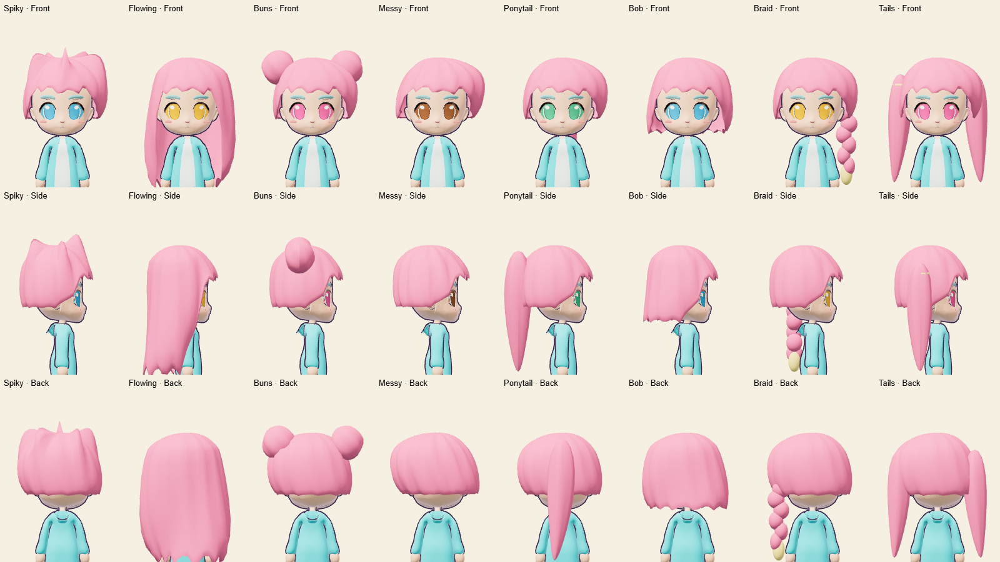
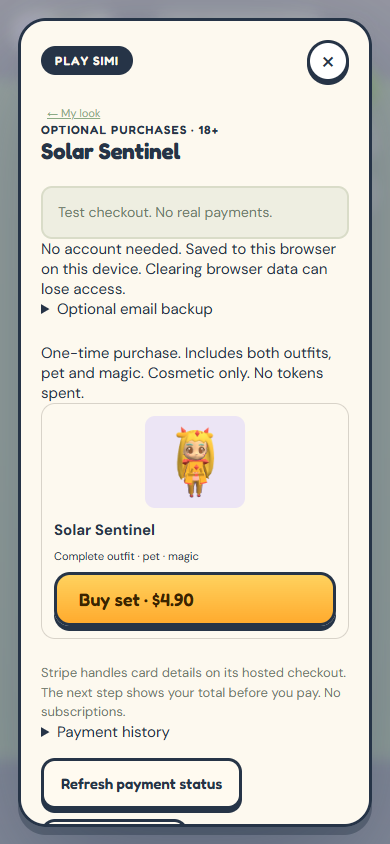

# Longer hair and guest purchases and rankings

Guests can buy a set after adult confirmation, earn Style Tokens, enter daily,
weekly and season rankings, and challenge validated scores without email.
Email remains an optional way to recover the same character on another device.

## What changes

- Longer flowing cuts, bobs, ponytails and twin tails. Softer relief and side/back
  waves keep the existing continuous hair shell and hat fit. IDs and ownership
  are unchanged. The shell still has 1,392 triangles. All 426 hair-bearing
  fallback previews were regenerated; 413 image files changed.
- The selected set gets one purchase screen with its configured SGD total.
  Guests see an enabled checkout after confirming they are 18 or older.
  Donations stay off the selected-set screen; email backup sits in details.
- Confirmed purchases and progress are cached in the browser. A HttpOnly device
  cookie reopens the server-verified profile for up to 365 days and renews when
  the app opens. Still-valid older guest sessions upgrade on their next visit.
  Account sessions keep their 30-day expiry. Revoked and expired sessions cannot
  renew. The existing one-year inactive-profile deletion still applies.
- Guest rounds now qualify for rankings. Daily medal tokens retain the cap of
  three per Singapore day; XP still earns one Style Token per 100 XP. Rankings
  show the next token goal. First-finish assisted Coast Rush remains unranked.
- Guest challenges have no email or 24-hour wait. Replay validation, elapsed-time
  checks, three outgoing challenges a day, repeat-target restrictions, blocks
  and suspensions remain. Earlier unranked rounds are not rewritten.
- Saving the first character setup returns directly to play without an email
  form. Explicit email backup and account privacy controls remain available.

Browser storage alone does not prove ownership or restore a cleared cookie.
Clearing browser data, changing browsers, private browsing or a year away can
lose access without optional email backup. This is not offline checkout.

## Review evidence






The purchase image uses a synthetic S$4.90 fixture price. It does not change
production prices. Browser review uses real UI buttons, local SQLite and the
Cloudflare API handler, with simulated Stripe responses and world presence.
It checks adult confirmation, checkout, verified fulfillment, local purchase
cache, a new browser context restoring the same guest, and rankings without
opening the email dialog. Screens were tested at 320x568, 390x844, 844x390 and
1280x800 with no page errors or horizontal overflow at checkout. These are
Chrome viewport emulations, not physical iOS or Android tests.

## Validation results

- Production build and Cloudflare dry-run pass with the existing bundle-size warning.
- Full Chrome-enabled suite: 499 passed, none failed or skipped.
- Cloudflare runtime suite: 15 passed, none failed or skipped.
- Guest browser flow: all four viewports passed with zero page errors.
- Records benchmark: 1,000 players and 20,000 runs retain the fixed query budget;
  the index-free snapshot takes 39 queries. Hair triangle counts are unchanged.

## Repeat the checks

Windows PowerShell, with Chrome and Playwright Core installed:

```powershell
$env:DARECADE_TEST_CHROMIUM = 'C:/Program Files/Google/Chrome/Application/chrome.exe'
$env:PLAYWRIGHT_CORE = 'C:/path/to/playwright-core/index.mjs'
npm run build
npm test
npm run test:cloudflare
node --experimental-strip-types scripts/guest-flow-review.mjs
```

Run `scripts/hair-fit-review.mjs longer-after` with Vite at port 5176 to capture
both bodies, all eight hairstyles, headwear and poses. The review retains the
18,650 to 20,634 triangle range per front-view avatar; no frame-rate claim is made.

Real charges, physical phones and production deployment are outside this PR's
validation. No database migration or payment configuration change is needed.
