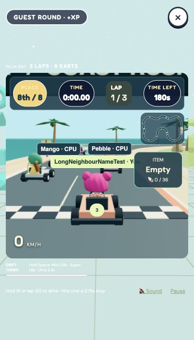
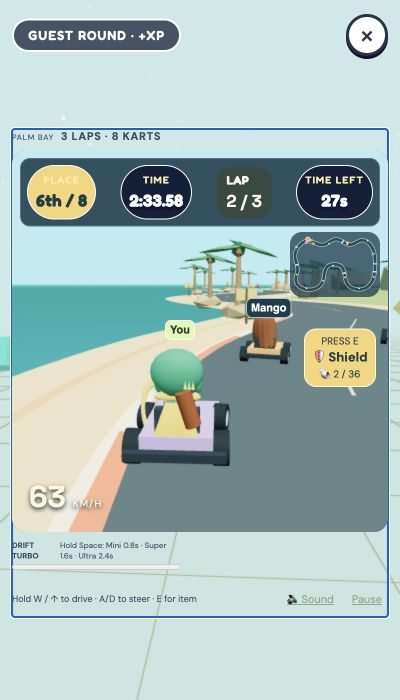
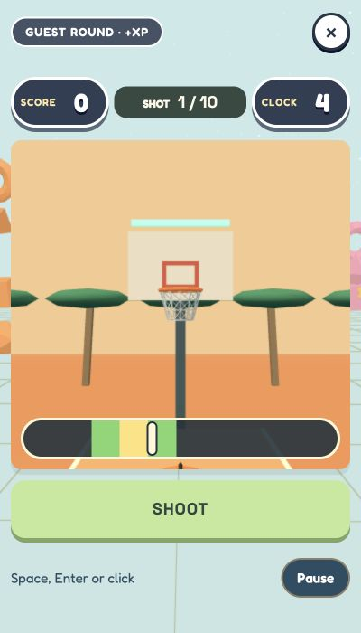
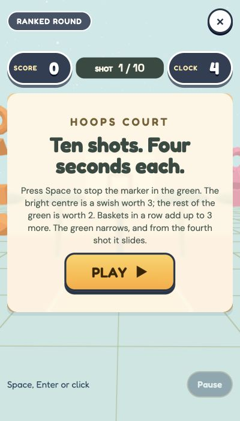
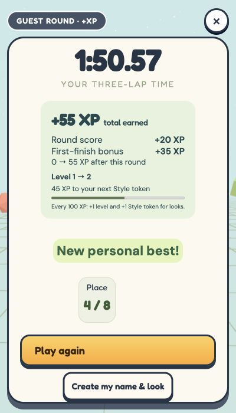

# 3D-only QA and release checks — 8 October 2026

## Scope and baseline

Started from current `main` (`7b0413fb31279e329fe0e4ba991f723f5350ef36`), with a clean checkout, no open overlapping PRs and no repository/ancestor `AGENTS.md`. Read README, hosting guidance and package scripts. Dedicated branch: `codex/3d-only-qa-polish`. Baseline build and all 499 tests passed with Chromium enabled.

All local play used synthetic fixtures or the separate `/private/tmp/playsimi-3d-qa-data` database. No real player account, purchase, production reset or economy change. No new game or cinematic intro.

## Findings and changes

| Finding             | Reproduction and resolution                                                                                                                                                                                                                                                                                                                                                                                                                                                                                            |
| ------------------- | ---------------------------------------------------------------------------------------------------------------------------------------------------------------------------------------------------------------------------------------------------------------------------------------------------------------------------------------------------------------------------------------------------------------------------------------------------------------------------------------------------------------------- |
| 2D fallback         | Existing browser tests confirmed the saved `twoD` preference and unavailable WebGL entered the old lobby. Removed the mode and all production references. WebGL 2 is checked before onboarding/world requests; failed startup shows an accessible, focused Retry screen. Actual context loss stops world/race/Hoops/Fishing without a playable fallback.                                                                                                                                                               |
| Race input guidance | Baseline chose input only once from the primary pointer. Confirmed static keyboard copy in narrow/hybrid states. Last touch/pen/control input and keyboard driving keys now update acceleration, item, drift and footer guidance. Keyboard support is independent of width.                                                                                                                                                                                                                                            |
| Camera obstruction  | Investigated without reproducing the severe transient obstruction. Walked from plaza `(0,10)` to arcade approach `(-4.94,-5)`, across cabinets to `(-13.64,-5)`, around corner `(-16.52,-11.72)` and against wall `(-14.36,-11.72)`. Switched bird’s-eye/third-person views and entered/closed Play and My Look. Avatar remained visible through existing prop dithering; follow distance stayed 7.00 with no forced zoom. No speculative camera algorithm change. Original resume-only incident remains unreproduced. |
| Mobile HUD          | Long player labels and item card reproduced at 400×700. Compact labels use “You”, shorten CPU names, avoid overlap and limit nearby labels; narrow/short layouts have smaller item cards with at least 44px targets. Fixed inherited white guidance against pale frame.                                                                                                                                                                                                                                                |
| Ready states        | Reproduced launcher automatically clicking games' existing Start buttons. Hoops/Fishing were already playing when opened. Removed automatic clicks; repeated Start is idempotent. Both wait for graphics readiness. Noodle’s existing first-move behavior remains.                                                                                                                                                                                                                                                     |
| Loading copy        | Reproduced racing-specific shared loading text for other games. Visible text and progress labels now name the selected activity.                                                                                                                                                                                                                                                                                                                                                                                       |
| Rewards             | Reproduced race 20+35=55 XP and Hoops 1+10=11 XP, moving 55→66. Hoops bonus is the existing 5 XP per new personal-best basket; Fishing also has existing new-species bonuses. Stored receipts list every component and total, plus unlock progress. Duplicate finishes return the original receipt without awarding again.                                                                                                                                                                                             |
| My Look             | Free equips and Undo worked; locked preview remained selected after closing/reopening. Close now cancels preview. Saved/saving/failed/preview status is explicit. A queued failure followed by success clears the stale failure message.                                                                                                                                                                                                                                                                               |

## Removed and preserved

Removed: main's 2D lobby renderer/location fallback, `enable2D` path, mode switch, `twoD` save/preference field, 2D-only avatar-portrait branch, 2D world CSS, 2D-only inspection/emote/wardrobe branches, simplified race renderer and Hoops/Fishing meter-only graphics-failure mode. Removed always-false `simple` plumbing for Stage and Plots. Replaced the fallback browser suite with supported-3D style-reward and explicit unsupported-graphics coverage.

Preserved: all HTML menus/HUD/accessibility controls; destination navigation; intentional 2D arcade games; race minimap; wardrobe thumbnails and owned-item rules; Stage note highway; Plot SVG/HTML controls and their optional decorative 3D layer; avatars, neighbourhood models and shared assets. No shared assets were deleted. Primary menu choices are paged in threes; Menu → Neighbourhood keeps Go there, Play outside and Change world.

Data: normalisation drops only the retired preference; unrelated preferences, ownership and progress remain. Receipts add a nullable `runs.reward_receipt` column through the existing additive schema updater. Previously finished runs without a receipt are labelled honestly. No Durable Object binding, migration tag, account/auth/privacy policy, reward formula or simulation rules version changed.

## Verification

Passed before release:

- Build and TypeScript (`npm run build`). Existing large-bundle warning only.
- 515/515 Node/browser tests, zero failed/skipped, with installed Mac Chromium. Includes 360/390/430×700 portrait, 700×360/390/430 landscape and 1280×800 desktop race layouts; hybrid switching; overlap and touch targets.
- 15/15 Cloudflare integration tests, build and deployment dry-run.
- Actual `WEBGL_lose_context` tests for world, race, Hoops and Fishing; unsupported graphics before account requests; explicit Retry without an automatic loop; old preference migration preserving saves.
- Controlled 30-second ready waits for Hoops/Fishing/Noodle, repeated Start, pause/resume, focus loss, close/reopen/restart. No time or attempts consumed before Start.
- Server replay tests: complete race, two-basket Hoops and Fishing receipts reconcile, repeated finishes are identical, database reopen preserves them, altered replay retries are refused.
- Real-time local browser race completed in **1:50.57**, three laps, fourth place. Receipt **55=20+35 XP**; lobby/reload both 55. An earlier incomplete run correctly awarded 0.
- Real local Hoops ready screen waited over 30 seconds at shot 1/10 and clock 4. Explicit Start, shot, Pause/Resume, full ten-shot round and server-saved 0-XP result worked.
- Real local free Rookie Hero outfit, green eyes, another outfit + Undo, close/reopen/reload retained the owned selection and eyes. Synthetic fixture additionally verifies locked preview, cancel and ownership invariants.
- Separate reviewer found graphics-loss and queued-save issues; both fixed, targeted coverage added, re-review found no remaining blocking code issues.

One intermediate suite failed because a simultaneous Cloudflare build temporarily replaced `dist/index.html`. Repeated with stable build files: 515 passed. Earlier test-harness failures were fixed; none are counted as passes until rerun.

No lint script/config is supplied; changed code is checked with the repository's Prettier. Physical phones, Safari/Firefox and the original intermittent resume-only camera incident are untested/unreproduced. These checks are responsive desktop emulation, not physical-device evidence. A raw-debugger request to an optional local camera fixture was denied; ordinary browser controls were used instead, without bypassing that restriction.

## Screenshots

| Before                                     | After                                     |
| ------------------------------------------ | ----------------------------------------- |
|        |        |
|  |  |

Camera evidence: [arcade arrival](camera-arcade-arrival.jpg), [corner](camera-arcade-corner.jpg), [after My Look](camera-after-look.jpg).

## Release gate and rollback

Draft PR, final-commit checks and production verification are recorded in the PR. No branch-protection or active branch rules were returned at inspection; do not bypass any subsequently added gate. Deploy only reviewed merged code through `npm run cf:deploy`. Verify production asset bytes against that build, health, 3D startup, race, navigation, My Look/save/reload, controlled unsupported graphics, and client/server errors.

If the release regresses, redeploy the prior Worker version/code using the established Cloudflare rollback workflow. Keep the additive receipt column and all player data; never reset storage. Production remains unverified until the release record says otherwise.
