# Wardrobe implementation verification

## PR 1 — Fitting room

Character settings precede the catalogue. Face/full-body cameras and an expanded
preview retain the selected avatar, pet and magic. In 2D the art is explicitly a
catalogue sample; it cannot represent custom combinations. Owned tap-to-equip,
Undo, locked try-on and payment entry points remain.

Validated on isolated synthetic profiles: production build, 21 avatar/catalogue
regression checks and 6 Chrome browser fixtures (320×568, 390×844 guest/account,
844×390, 1280×900, and 320×568 2D). Browser checks include the new camera controls,
expanded preview, settings ordering, catalogue scrolling, free equip, Undo and
locked previews. This is browser emulation, not physical-device certification.
Evidence: `.browser/wardrobe-menu-*.png` and corresponding HTML assertion reports.

Thumbnail capture is serialized by the review page, awaited before disposal, and
blob URLs are released. The preview restores its camera even if encoding fails.
No account, privacy, age gate, ownership, price or earning-rule changes.

## PR 2 — Mix and match

Adds Clothes, Hair and Headwear alongside complete outfits, pets and magic.
Uses existing clothing/hair/baseHair/hat fields and original item indices: no
migration, price change or entitlement conversion. All 80 existing hairstyles
remain free. No-headwear preserves the visible hairstyle. Undo captures visual
fields only. Server ownership enforcement remains authoritative.

Validation: build; 12 catalogue/component/ownership regression checks; all six
browser fixtures with independent hair/headwear/clothes interactions. Rendered
120 clothing/headwear PNGs from the production builder. Existing saves roundtrip
without losing identity, pets, magic or purchases. Fixtures use synthetic data.

## PR 3 — Six original families

Appends six sets (indices 60–65); all 60 existing sets remain available with their
original IDs, visuals, costs and entitlements. After-school Circuit and Void Deck
Weekend are free; Monsoon Wayfinder costs 18 tokens and Canal Otter Club 24;
Rainshield Guardian and Moonbell Society use the existing S$1.99 Premium path.
The server already supports inline prices for appended sets. No Stripe request
or real purchase was made. Purchase age confirmation is unchanged.

These are original primitive meshes fitted to the existing body/skeleton, with
existing free hairstyles and no new textures or third-party asset licences.
Each adds two cached overlay draws and fewer than 4,000 overlay triangles.
The clothed base model is additional to that budget. Both bodies are supported.

Validation: build and 44 avatar, catalogue, geometry-budget, browser and payment
checks. Real WebGL review captured all six families on both bodies at gameplay
and fitting-room distances. Bench, swing and arcade screenshots use Void Deck
Weekend; all families pass finite-pose checks for idle/walk/dance/bench/swing/
arcade. Art-review verified 470 cosmetic swaps across nine modes, independent
rigs, 24 remote avatars, preview teardown and reduced motion. These checks are
not a claim that every possible mix is clipping-free. Evidence is in
`output/playwright/wardrobe-implementation/`. No physical-phone test or teen
preference study has been performed.

## PR 4 — Saved looks, collecting goals and companion identity

Adds four visual-only saved slots and one favourite-set preference. The client
and server validate components, reject saving unowned pieces, and recheck ownership
when applying snapshots. Refunded snapshots cannot restore entitlement. Existing
clients can patch preferences without erasing the new fields. Old saves receive
empty slots. No SQL migration, earning-rate change, timer or notification added.

Drakes now have upright bodies, two feet and broad wings; wolves have longer legs;
Canal Otter has a low body and paddle tail. Books/notebooks and paper planes render
literal objects. The Wayfinder compass uses shared merged geometry. Preview images
were regenerated from the production builders. No player accounts, email sends,
real checkout requests or live purchases were used during verification.

Final verification:

- Production TypeScript/Vite build passes (existing Three.js chunk-size advisory remains).
- 489 tests pass with the installed Chrome executable, no skips. This includes
  mobile/desktop/fallback, saved looks, ownership, payment and safety checks.
- 14 Cloudflare integration tests pass, including payment, world privacy and
  durable storage; Wrangler deployment was a dry run only.
- After the final effect optimisation, 24 avatar/companion/effect checks pass.
- The ordinary mobile workload benchmark passes. All six complete new sets,
  including their pets and magic, also pass at 390×844 and 844×390 in both cameras.
  Peak draws by family: Circuit 516, Rainshield 519, Wayfinder 515, Moonbell 519,
  Otter 515, Void Deck 520 (limit 520). Matrix updates peak at 2054 (limit 2300).
  Pixel ratio remains capped at 1.25, with shadows off. This measures workload in
  desktop Chrome with emulated phone dimensions, not real-phone frame rate.
- New drake/wolf/otter meshes measure 3672/4608/4544 triangles and 8/6/6 draws.
  Notebook magic uses 120 triangles and paper planes 84; both retain 32 particles.
- Stale fallback/season test fixtures now use auth/session. Onboarding tests now
  exercise the current unchecked 13+ and privacy checkboxes instead of the retired
  date-of-birth form. Production age/privacy implementation was not changed.

Evidence: `.browser/pr4-final-tests.log`, `.browser/pr4-cloudflare.log`,
`.browser/wardrobe-render-report.json`, `.browser/pr4-effects-recheck.log`,
`output/playwright/wardrobe-implementation/saved-and-favourite-desktop.png`,
`expanded-mobile.png`, `face-preview-desktop.png`, and the family/pose captures.

Rollout gates: merge PRs in order; deploy server and client together; retain new
catalogue IDs on any rollback after new ownership is granted. Current safeguards
and receipts stay in place. Before a broad release, validate on physical Android/
iPhone devices and run a small opt-in style-preference study with suitable age
and privacy handling. No measured retention or sales uplift is claimed.

## Review screenshots

These captures use an isolated synthetic profile. They show the implemented
favourite goal, saved-look slot and expanded mobile fitting room.

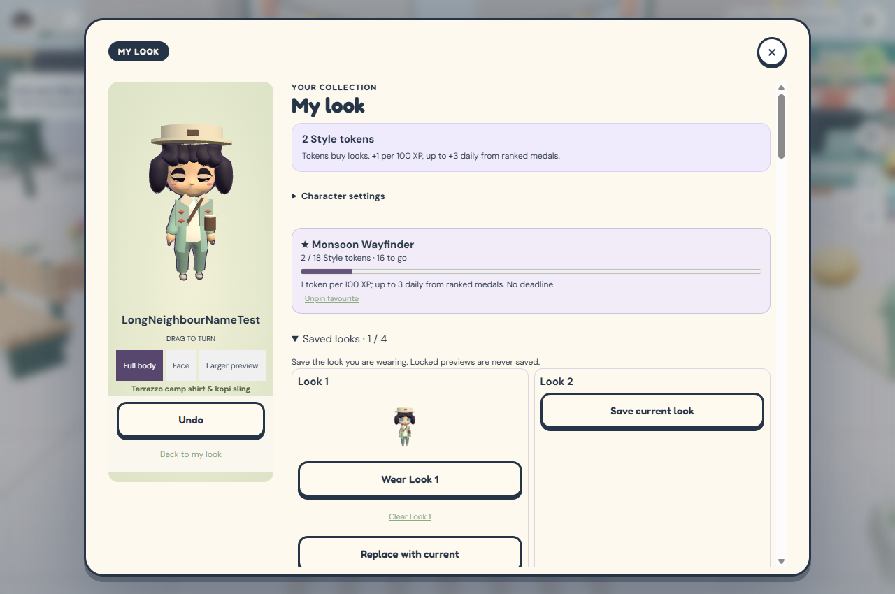

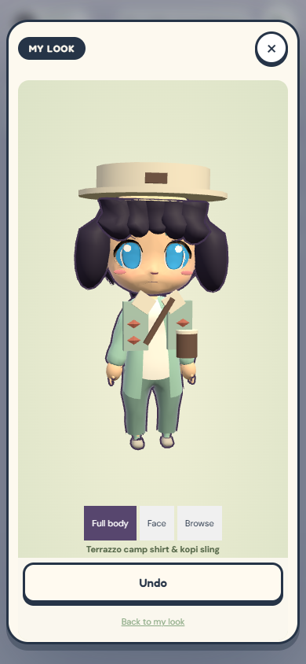

The current production-builder outfit thumbnails for the six families:

| Circuit | Rainshield | Wayfinder |
| --- | --- | --- |
| 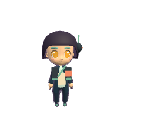 | 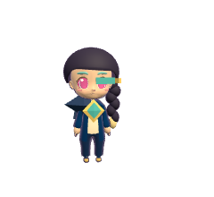 | 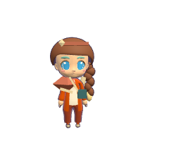 |

| Moonbell | Otter Club | Void Deck |
| --- | --- | --- |
|  | 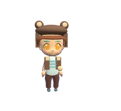 | 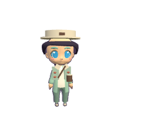 |

## Hair, cap and token-price follow-up

The repeated five front/rear hair clumps were shared across every hairstyle. They
are replaced with separate fringe/nape recipes, including a rounded messy cut.
Open crowns, ears and headbands retain scalp coverage; Eclipse/Crystal crowns
sit above the hair. Face zoom includes the crown. Hair cards now opt into the
thumbnail loader instead of remaining at CSS opacity zero. 618 catalogue images
were regenerated from the current production renderer.

Legendary sets cost 8 tokens, clothes 5, and headwear/pets/magic 4 each. Owned
pieces reduce the remaining set cost. New component IDs are server-owned entries
in the existing unlock array. The debit ledger retains actual historical spend.
Lilac cap grants are retired; owners retain their cap and the first finish keeps
its 35 XP reward. Age/privacy and cash-purchase rules are unchanged.

Validation: production build; 491 Node/browser tests with no skips; 15 Cloudflare
integration tests including concurrent piece redemption and discounted upgrades;
24 mobile workload cases under existing limits. The local production WebGL UI
verified loaded hair images, both crowns, a 5-token clothes unlock followed by a
3-token set upgrade, and persistence after reload. Portrait 390×844 and landscape
844×390 checks use desktop Chrome emulation, not physical phones.

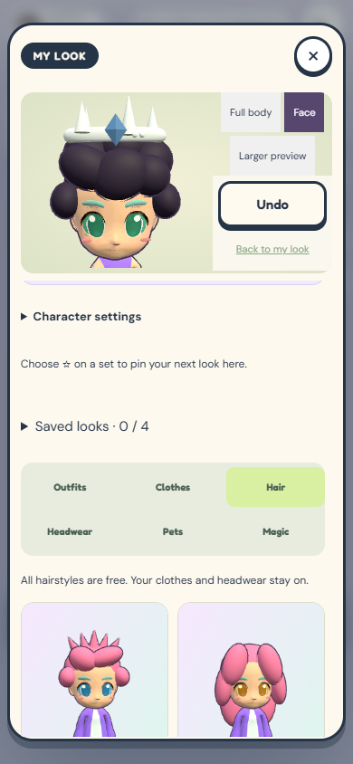
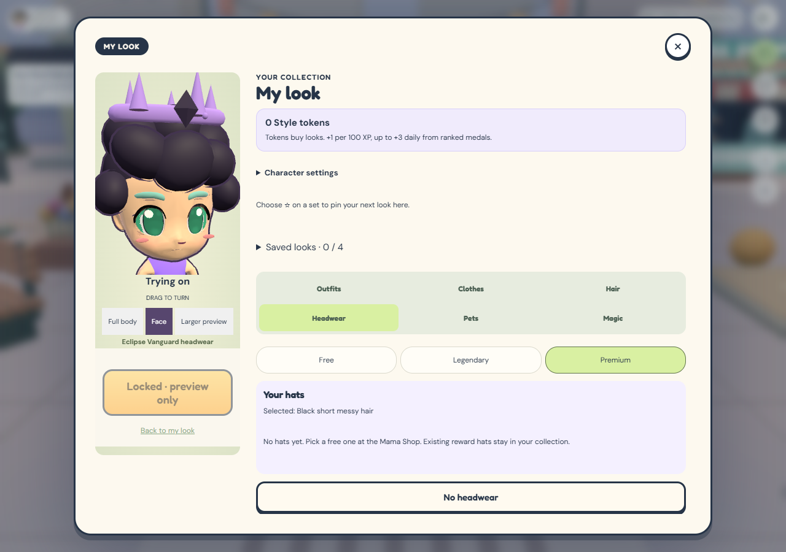

## Continuous hair surface and crown fitting research

The previous fix reduced the number of spheres, but retained overlapping fringe,
temple and nape ellipsoids. Each intersection still produced a raised lump and an
outline seam. This is a geometry problem; recolouring or smoothing the lighting
alone cannot remove the silhouette.

The replacement uses one indexed surface for scalp, fringe and nape. Flowing
hair and bobs extend that same surface. Buns, ponytails, braids and twin tails keep
their named appendages. A small inward hairline rim gives the surface thickness.
The eight cuts retain their IDs, colours and saved selections. Royal/knight
crowns, including Eclipse and Crystal, are lowered from a lowest point of 1.88
to 1.72 model units. There is no calibrated physical-inch scale for this chibi.
A second bug flattened hair based on the starter clothes even when their default
hat was replaced by a crown. Hair fitting and class-head rendering now share the
same visibility condition. This prevents Lantern Mage, Orchard Archer and Coral
Pirate clothes from exposing the scalp beneath an unrelated crown. Other fitted
hats retain their existing positions and use a tucked hair surface.

Research basis, checked 7 October 2026:

- [Blender Shrinkwrap](https://docs.blender.org/manual/en/3.6/modeling/modifiers/deform/shrinkwrap.html)
  describes fitting a mesh to another surface with an offset. For future artist
  work, an authored hair shell can be fitted to the existing head in this way.
- [Blender Solidify](https://docs.blender.org/manual/en/3.6/modeling/modifiers/generate/solidify.html)
  adds thickness to a mesh surface. The prototype uses an inward perimeter rim
  instead of a full interior shell to avoid hidden geometry.
- [Three.js custom BufferGeometry](https://threejs.org/manual/pages/custom-buffergeometry.html)
  and [vertex normals](https://threejs.org/docs/pages/BufferGeometry.html#computeVertexNormals)
  support shared indexed vertices and averaged normals. Those are used directly
  here. Merging independent spheres into one draw call does not weld their surfaces.

The proposed art trade-off is a simpler, smoother silhouette. A future sculpted
version could add a few tapered locks following the scalp; avoid adding rounded
forehead/nape beads again. No external assets or additional textures are used.
The shell is 1,392 triangles before its outline, cached per cut and cap fit across
colours. Compared with the previous renderer, the messy avatar is 2,256 rendered
triangles lighter including outlines; ponytail and braid are 264 higher. Draw
calls remain within the existing budget. This is not a measured FPS improvement.

Validation: 494 Node/browser tests passed with no skips, production build passed,
and 24 mobile workload cases passed with at most 520 draws and 2,054 matrix
updates. Two added topology tests check all eight styles in both cap states for
connected geometry, shared seams, finite normals, noncollapsed triangles and
cache isolation. A browser regression checks full scalp coverage in 192 crown,
starter-clothes, hairstyle and body combinations. 618 catalogue thumbnails were
regenerated. Both character
options were rendered front/side/back, with Eclipse/Crystal/Solar headwear and
all three earned hats. Synthetic pose captures and a local production build
verified previews; these do not establish collision-free interaction with every
world prop. Mobile checks used desktop Chrome at 390x844 and 844x390, not phones.

The local profile only equipped a free hairstyle and previewed locked crowns;
there were no purchases or production-player changes. Save, ownership, pricing,
privacy and age-gate code are unchanged. This follow-up is prepared for visual
review and is not deployed.

Reproduce in Windows PowerShell with the local art server on port 5176 and
PLAYWRIGHT_CORE pointing to the installed playwright-core/index.mjs:
`node scripts/hair-fit-review.mjs after`.

Before:

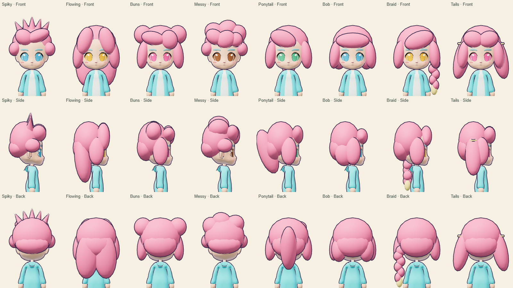

Proposed continuous surface:

Lowered crowns:

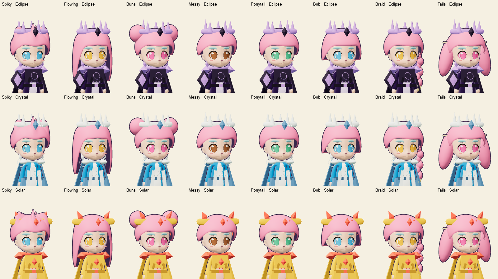

Crowns over starter clothes, including the previously bald Lantern Mage case:

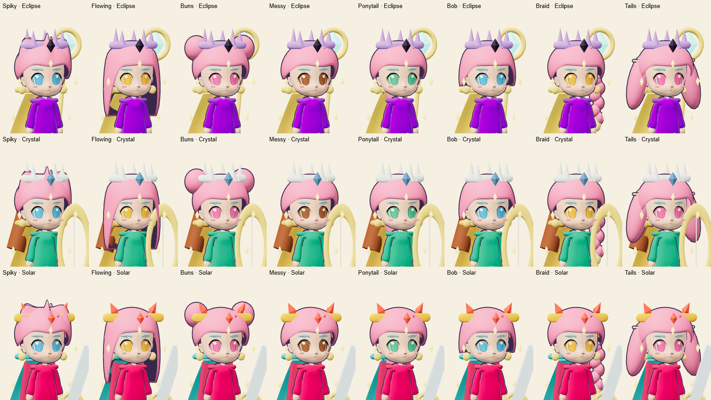

### Fringe placement follow-up

Lowered the fringe to just above the eyebrows across all eight cuts, with extra
forehead clearance to avoid skin poking through. The same geometry is used for
both character options. Crown seating at 1.72 applies equally to male and female
avatars, as does the fix preventing starter clothes from flattening crown hair.
Both options were rendered with the lower fringe, crowns, hats and starter
clothes. The 192-combination crown regression was rerun for this change.

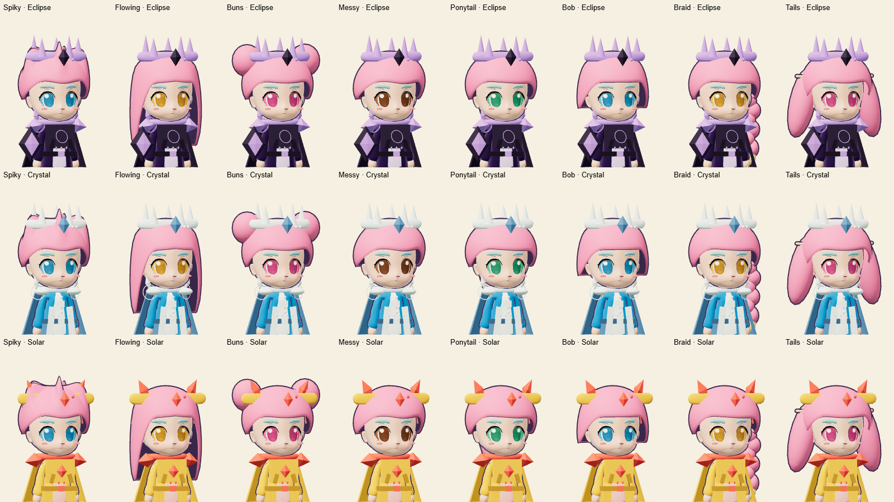
