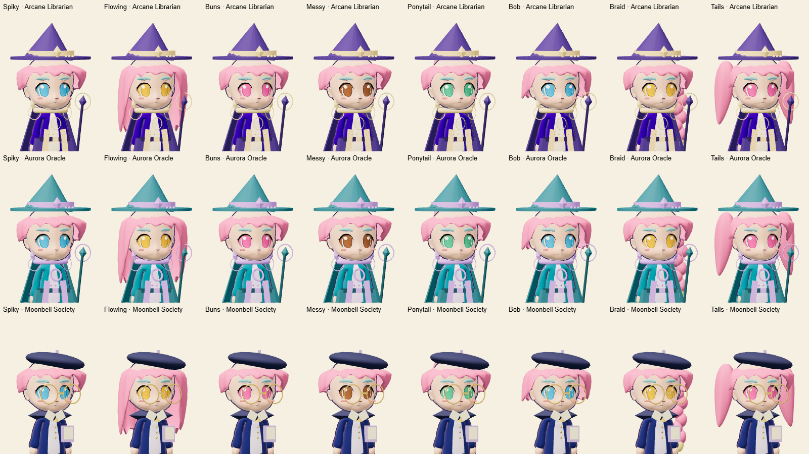
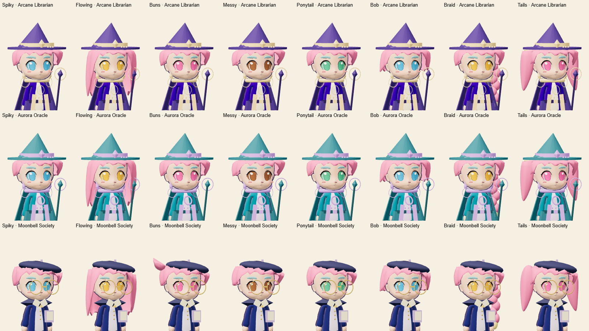

# Headwear coverage and collection cleanup

Arcane Librarian, Aurora Oracle and Crescent crystal tiara now use the lower
brim seat already verified for Apprentice Mage and Moon Academy. The seat is
selected by their shared mage geometry instead of maintaining an incomplete
list of item IDs.

Moonbell's beret and top pin move down 0.08 model units. Its round glasses keep
their original placement. Hair retains its full volume before the existing
headwear fitting pass, filling the exposed side of the asymmetric beret while
still giving the headwear priority.

The empty **Your hats** panel, selected-item message and shop reminder are
removed. Earned reward hats remain available as compact equip buttons. No item
IDs, unlocks, saved looks or progression fields change.

[Crescent headwear after fitting](evidence/crescent-headwear-after.png)

The headwear gallery covers all eight hair shapes on both bodies. The review
script accepts `HEADWEAR_REVIEW_IDS` as three comma-separated set IDs, for
example `arcane-librarian,aurora-oracle,moonbell-society`. Catalogue thumbnails
are regenerated from the same meshes. Regression checks verify that the empty
panel is absent and earned hats remain available.

Collection checks at [390 × 844](evidence/headwear-clean-portrait.png),
[844 × 390](evidence/headwear-clean-landscape.png), and
[1280 × 800](evidence/headwear-clean-desktop.png) confirm the notice is absent.
Mobile checks use Chrome viewport emulation rather than a physical phone.

Validation: all 496 application/browser tests and 15 Cloudflare tests passed
without skips. The existing earned-hat test verifies the empty state emits no
panel and claimed hats still have their equip/remove controls.
