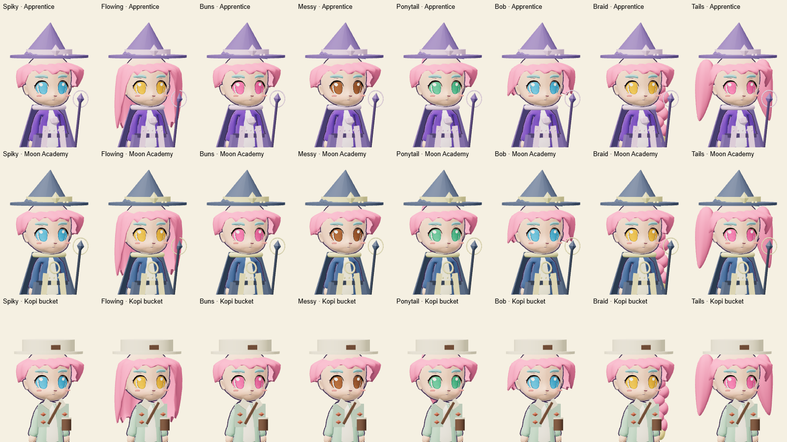
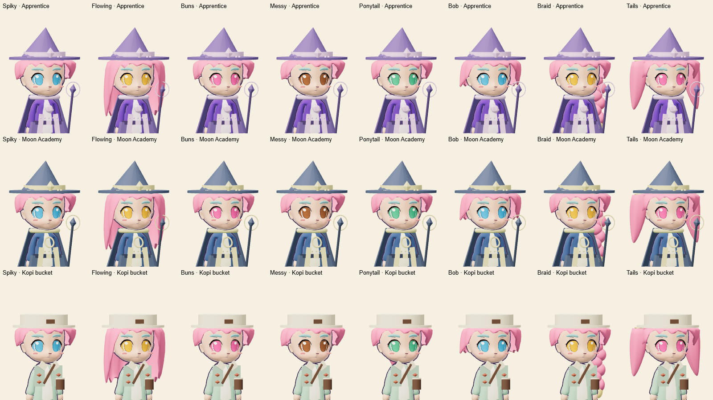

# Headwear fit and preview return

Headwear now takes priority over intersecting hair. A cached fitting pass tucks
hair vertices behind the headwear surface along rays from the scalp. Uncovered
hair keeps its shape, and the shared original hairstyle is unchanged. Fitted
hair stays still relative to the hat instead of swaying through it.

Apprentice Mage, Moon Academy and Kopi canvas bucket hat sit 0.11 model units
lower, removing the bald gap between their brims and the hairline. Saved item
IDs, ownership, currencies and player progression are unchanged.

The larger preview's **Back to my look** button now exits the enlarged layout
as well as resetting the try-on. The camera toolbar's return button explicitly
says **Back to collection**. The enlarged panel fits its container, with the
return toolbar above the canvas so controls remain reachable in landscape.

The existing browser fixture reproduced the reset-button bug before the fix.
Regression checks now cover both return paths and visible, unobstructed touch
targets. Headwear geometry tests cover transformed avatars, fitting priority,
uncovered hair, cache reuse and preservation of the original geometry.

The review gallery covers eight hairstyles on both bodies, the three lowered
hats, earned hats, crowns and starter outfits. Mobile checks use Chrome viewport
emulation, not physical phones.

- [Portrait return to collection](evidence/preview-return-portrait.png)
- [Landscape expanded controls](evidence/preview-expanded-landscape.png)
- [Desktop return to collection](evidence/preview-return-desktop.png)

Validation: 496 application/browser tests and 15 Cloudflare tests passed without
skips. The final layout also passed all six wardrobe browser cases and real
Playwright clicks at 390 × 844, 844 × 390 and 1280 × 800. Build and Wrangler dry
run passed, with the existing bundle-size warning. Refreshed the affected
fallback thumbnails from the real meshes. Fitting runs when a look is built and
is cached; it adds no per-frame raycasts or rendering passes.
