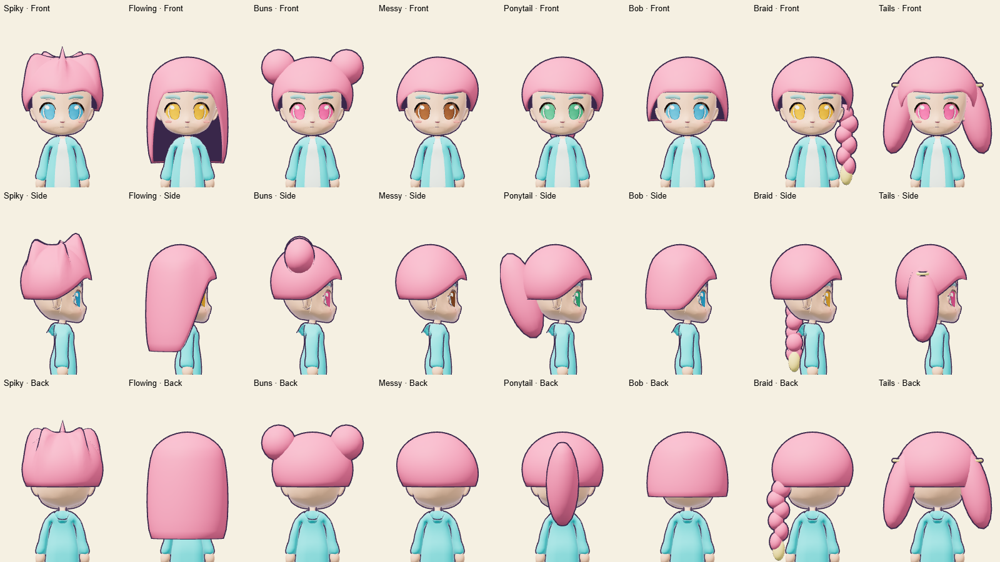
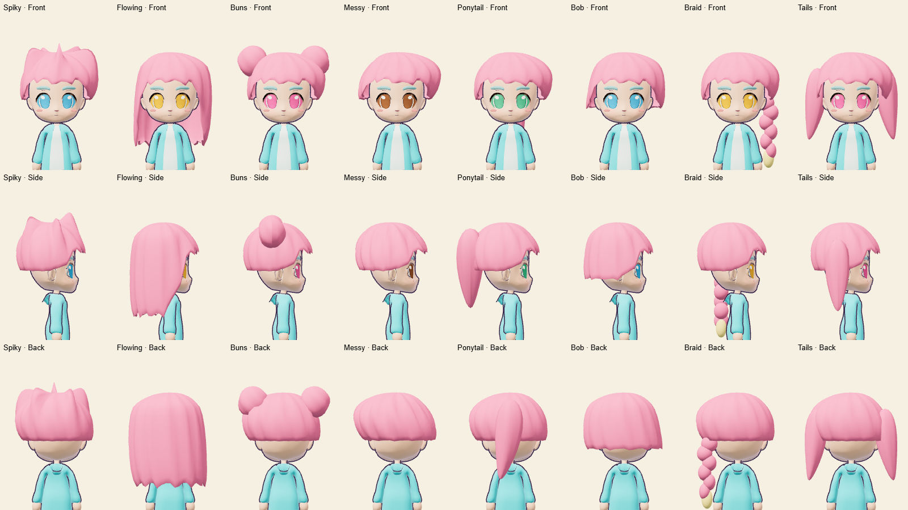

# Natural character hair

The smooth cap and blunt fringe now have swept ridges, uneven tapered ends and
small temple locks. Ponytails and twin tails curve and taper; buns have wrapped
ridges. Hair uses a rougher, double-sided material so the underside of long cuts
remains visible. Removing the inverted hair outline avoids dark streaks where
the outline intersects the grooves. Other character outlines are unchanged.

Geometry and materials are cached. The scalp remains one connected surface at
1,392 triangles, including its inward rim. In the review scene, the eight front
views use 18,650–20,634 triangles per avatar, compared with 20,042–23,610 before.
These are renderer triangle counts, not frame-rate measurements.

The 426 existing hair, clothing, outfit and set fallback thumbnails are refreshed
from the real meshes. Item IDs, colours, ownership and save formats are unchanged.

## Visual evidence





- [390 × 844 portrait](evidence/natural-hair-portrait.png)
- [844 × 390 landscape](evidence/natural-hair-landscape.png)
- [1280 × 800 desktop](evidence/natural-hair-desktop.png)

The review script captures both bodies, all eight styles, hats, crowns, starter
outfits and pose fixtures without page errors. Mobile evidence uses desktop
Chrome viewport emulation, not a physical phone. It is an isolated character
review, not a production screenshot.

Validation: the production build passes with the existing large-chunk warning.
The full Chrome-enabled suite passed 493 of 494 tests; the remaining test hit a
Windows temporary-profile cleanup `EPERM` after its browser assertion passed.
Rerunning the affected wardrobe browser file passed all six tests, including
320 × 568 in 2D mode. No tests were skipped in either run.

## Reproduce

Windows PowerShell, with an installed Chrome and Playwright Core:

```powershell
# Terminal 1
node node_modules/vite/bin/vite.js --host 127.0.0.1 --port 5176

# Terminal 2: set this to your installed playwright-core/index.mjs
$env:PLAYWRIGHT_CORE = 'C:/path/to/playwright-core/index.mjs'
node scripts/hair-fit-review.mjs natural-after

$env:DARECADE_TEST_CHROMIUM = 'C:/Program Files/Google/Chrome/Application/chrome.exe'
$env:CATALOG_REFRESH_HAIR_LOOKS = '1'
node --experimental-strip-types scripts/render-complete-catalog.mjs
npm test
npm run build
```
